# Sistem Manajemen Sertifikat Pelatihan

Mini Project 3 PBO — **Muhammad Aulia Rahman · 2509116096 · Kelas C**.

Aplikasi CLI Java Maven untuk mengelola peserta, pelatihan Online/Offline, dan catatan sertifikat. Admin mengelola seluruh data; Petugas membaca master serta mengelola sertifikat. MySQL menyimpan data permanen. Snapshot sertifikat mempertahankan data ketika pencatatan disetujui; perubahan master tidak mengubah catatan lama. Koreksi yang disetujui mengganti snapshot versi aktif, dengan ID dan pencatat awal tetap.

Aplikasi tidak mencetak berkas sertifikat atau menentukan kelulusan. Riwayat adalah daftar sertifikat yang masih tersimpan, bukan seluruh versi perubahan.

## Menjalankan program

Lingkungan terverifikasi: JDK26.0.2, Apache NetBeans31, Maven3.9.16, MySQL8.4.10 melalui Laragon dan Connector/J26.7.0. Compiler memakai release26. Jalankan MySQL dahulu, lalu buka terminal pada folder proyek dengan Java/Maven tersedia:

```powershell
mvn clean package
java -cp "target/Minpro-3-PBO-ManajemenSertifikatPelatihan-1.0-SNAPSHOT.jar;target/lib/*" main.SetupDatabase
java -jar target/Minpro-3-PBO-ManajemenSertifikatPelatihan-1.0-SNAPSHOT.jar
```

NetBeans: Open Project → pilih folder proyek → JDK26 → Clean and Build → Run Project. Main class aplikasi `main.Main`; setup melalui `main.SetupDatabase` secara terpisah. Classpath di atas menggunakan separator Windows. Distribusi JAR harus menyertakan folder `target/lib`.

### Koneksi dan akun aplikasi

Baca [petunjuk awal](BACA-SEBELUM-MENJALANKAN.md) sebelum menjalankan program.

Default: host127.0.0.1, port3306, user MySQL root, password kosong, schema db_sertifikat_pelatihan. Variabel opsional DB_HOST, DB_PORT, DB_NAME, DB_USER dan DB_PASSWORD. DB_NAME hanya menerima schema aplikasi atau db_sertifikat_pelatihan_test. JDBC memakai TLS REQUIRED, UTF-8, connect timeout5 detik dan socket timeout10 detik.

| Role aplikasi | Username | Password akses penilaian |
|---|---|---|
| Admin |admin |Admin2026! |
| Petugas Sertifikat |petugas |Petugas2026! |

Akun aplikasi berbeda dari akun MySQL. Setup memasukkan2 akun,2 peserta,1 Online,1 Offline,1 sertifikat/snapshot. Nomor berikut pada pemasangan awal PST003/PLT003/SRT002. Password disimpan dengan salt dan hash PBKDF2-HMAC-SHA256600000 iterasi. Tanggal data awal mengikuti hari setup.

[Schema SQL](src/main/resources/schema-v1.sql) memuat enam tabel. Setup ulang mempertahankan data/hash/counter. Main memeriksa kesiapan tanpa setup/reset otomatis. Schema parsial ditolak untuk ditinjau karena DDL MySQL tidak atomik.

## Struktur package dan MVC

| Package | Peran dan file utama |
|---|---|
| main |[Main](src/main/java/main/Main.java): wiring/startup; [SetupDatabase](src/main/java/main/SetupDatabase.java): setup eksplisit |
| model |Entitas/sesi/snapshot/interface; [ManajemenData](src/main/java/model/ManajemenData.java): otorisasi/transaksi; DAO: SQL/ResultSet |
| controller |[SertifikatController](src/main/java/controller/SertifikatController.java): login/menu/formulir, preview/konfirmasi, pagination dan error |
| view |[ConsoleView](src/main/java/view/ConsoleView.java): input/password, retry dan output |
| config |[Koneksi](src/main/java/config/Koneksi.java): konfigurasi dan Connection JDBC |
| util |[Validasi](src/main/java/util/Validasi.java) dan [Kredensial](src/main/java/util/Kredensial.java): helper tanpa I/O menu |
| pengujian (src/test) |Runner unit/integrasi yang menggagalkan build ketika assertion gagal |

Controller tidak menyusun SQL; view tidak menyimpan entitas; model tidak membaca input menu atau mencetak ke console. ArrayList menampung hasil query; MySQL menjadi sumber data utama.

## Alur program

Startup memeriksa koneksi/schema → login → sesi dan menu sesuai role → pilih baca/CRUD → input dan validasi → model memeriksa izin/keunikan/referensi → transaksi → hasil → kembali menu. Login gagal meminta ulang; logout mencabut sesi dan kembali login. Keluar/EOF membuang formulir belum tersimpan. Commit bertahan setelah restart.

Tambah/ubah master langsung disimpan setelah semua field valid. Sertifikat memerlukan ID peserta/pelatihan dan tanggal, lalu preview snapshot serta konfirmasi y/t. Hapus juga meminta konfirmasi. Master yang dirujuk sertifikat tidak dapat dihapus; hapus sertifikat menghapus snapshot tetapi mempertahankan master.

Daftar/detail/pencarian/riwayat sertifikat memakai snapshot tersimpan. Koreksi menampilkan data lama dan calon, memeriksa konflik sebelum commit. `/batal` kembali ke menu utama saat login; `t` kembali submenu. Daftar5 data per halaman; prompt halaman hanya jika lebih dari satu halaman.

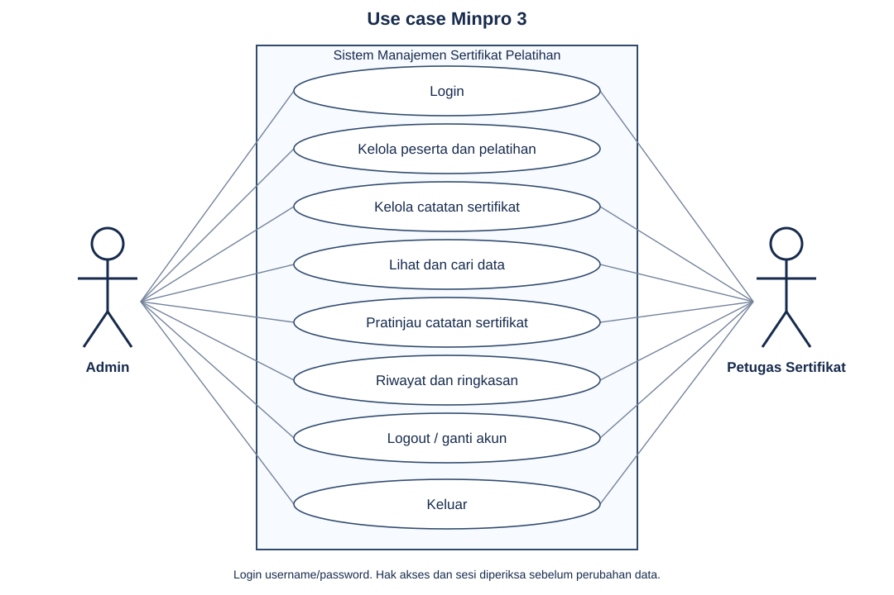

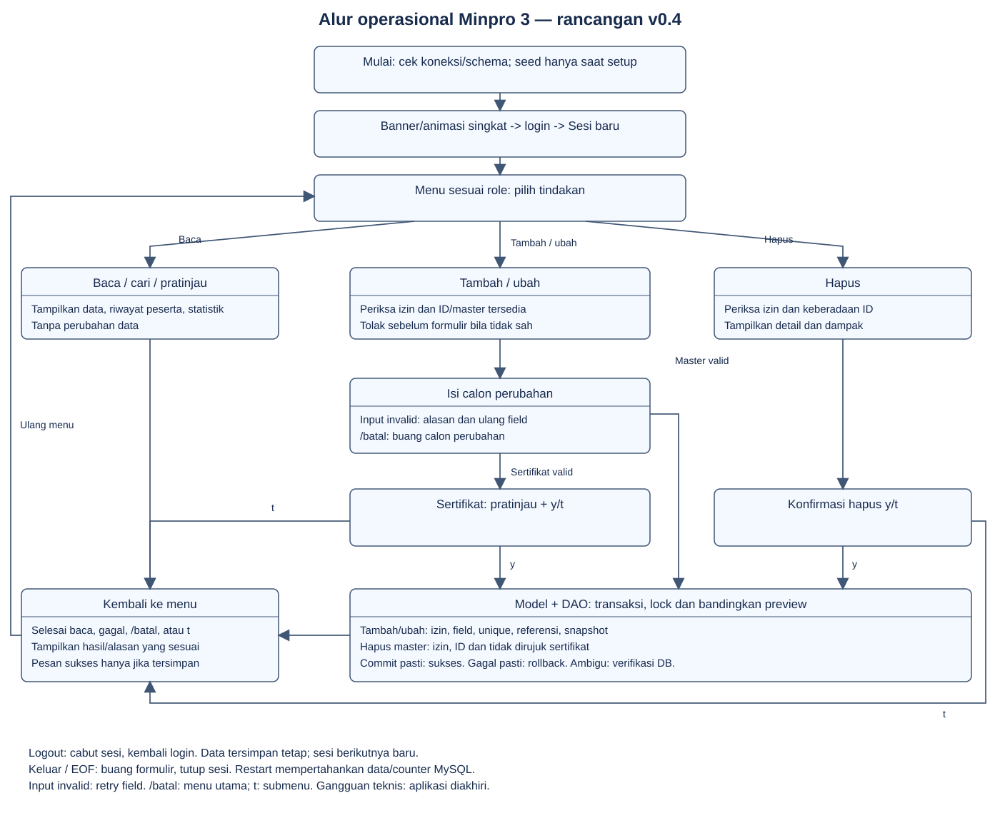

## Encapsulation dan inheritance

[Peserta](src/main/java/model/Peserta.java) dan [Pelatihan](src/main/java/model/Pelatihan.java) memakai atribut private; constructor/setter memvalidasi sebelum assignment. ID final tidak memiliki setter. Pengguna dan SnapshotSertifikat immutable; getter salt/hash mengembalikan salinan defensif. Mengubah objek hasil baca tidak otomatis mengubah DB: penyimpanan melalui ManajemenData.

[PelatihanOnline](src/main/java/model/PelatihanOnline.java) dan [PelatihanOffline](src/main/java/model/PelatihanOffline.java) extends Pelatihan, memakai constructor `super(...)` dan helper `super.getInfoDasar()`. Online menambah platform/tautan; Offline menambah lokasi/ruangan.

## Polymorphism dan abstraction

| Konsep | Lokasi dan pemakaian nyata |
|---|---|
| Overriding |Online/Offline override getDetailPelaksanaan() dan getJenis(); dipanggil melalui tipe Pelatihan pada detail dan pembentukan snapshot |
| Overloading |Pelatihan memiliki getDetailPelaksanaan() dan getDetailPelaksanaan(boolean). Controller detail memakai false; getRingkasan memakai true; snapshot memakai tanpa argumen |
| Abstract class |Pelatihan memuat atribut dan validasi umum; objek konkret berupa Online/Offline |
| Abstract method |getDetailPelaksanaan() dan getJenis() mewajibkan perilaku setiap subclass |

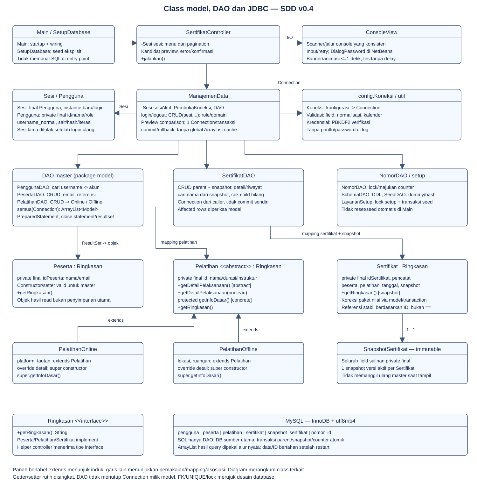

## Nilai tambah: interface

[Ringkasan](src/main/java/model/Ringkasan.java) mendefinisikan `String getRingkasan()`. Peserta, Pelatihan, Sertifikat dan PratinjauSertifikat mengimplementasikannya. Helper `ringkasan(Ringkasan data)` pada SertifikatController memanggil method tersebut pada hasil penyimpanan dan preview. Interface dipakai dalam menu nyata.

Interface merupakan nilai tambah pada ketentuan Minpro3. Database/login/animasi adalah fitur pendukung, tanpa klaim bonus resmi.

## Aturan dan database

Nama manusia menerima huruf Unicode dan tanda nama tertentu, menolak angka. Judul/platform/lokasi/ruangan memakai aturan teks berbeda: Java26 dan A-101 dapat sah. Email unik tanpa membedakan kapital; durasi1–500; tanggal2000-01-01 sampai hari ini; URL wajib mempunyai host.

ID PST/PLT/SRT otomatis dengan nomor minimal3 digit,999 berlanjut1000. Gagal/batal tidak mengambil nomor; hapus tidak memakai ulang ID. Counter memakai row lock. UNIQUE/FK/CHECK dan PreparedStatement menjaga data. Parent sertifikat/snapshot/counter memakai satu transaksi; DAO tidak commit sendiri. Jawaban commit yang ambigu dilaporkan belum pasti dan tidak diulang otomatis.

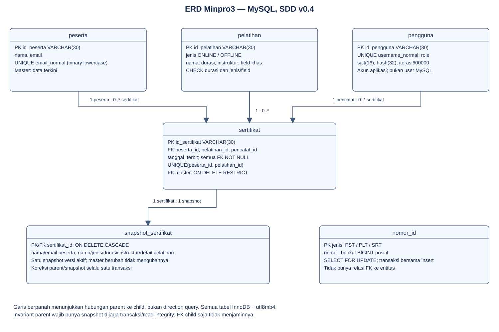

## Menjalankan pengujian

`mvn package` menjalankan pemeriksaan kredensial, domain, input console dan otorisasi sesi. Pengujian integrasi menggunakan database khusus:

```powershell
$env:DB_NAME = 'db_sertifikat_pelatihan_test'
java -cp "target/Minpro-3-PBO-ManajemenSertifikatPelatihan-1.0-SNAPSHOT.jar;target/lib/*" main.SetupDatabase
mvn -Puji-db verify
Remove-Item Env:DB_NAME
```

Integrasi memeriksa CRUD, validasi, pembatalan, snapshot dan transaksi. Database pengujian harus terpisah dari data aplikasi. Rincian pemeriksaan tersedia di [pengujian](docs/PENGUJIAN.md).

## Tampilan dan akses

Menu ditampilkan satu pilihan per baris. Daftar memakai tabel ASCII dengan lima data per halaman. NetBeans Run Project membuka dialog password bertanda bintang; masukkan password di dialog, bukan di Output. Terminal interaktif menyembunyikan password tanpa bintang. Admin mengelola seluruh data. Petugas dapat membaca peserta/pelatihan serta mengelola sertifikat.

## File MySQL

[Dump database](database/db_sertifikat_pelatihan.sql) berisi struktur enam tabel, akun aplikasi dan data awal. Pilih pemasangan menggunakan dump atau SetupDatabase; [petunjuk impor](database/README.md) menjelaskan langkahnya. Setup ulang mempertahankan data dan tidak mengganti password akun yang sudah ada.

## Dokumentasi penggunaan

Screenshot berikut diambil oleh pemilik proyek pada NetBeans tanggal 8 Oktober 2026. Bukti mencakup login, password tersembunyi, tabel data, validasi ID, snapshot, statistik dan pergantian akun. Screenshot diambil sebelum penggantian password; tampilan dan hak akses tetap sama.

### Login Admin

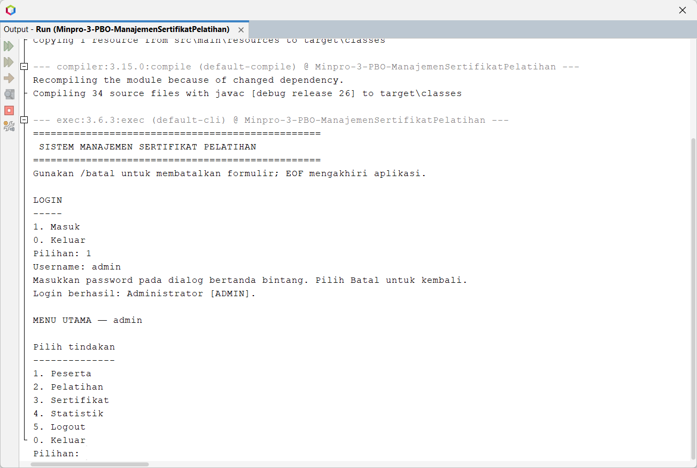

### Input password bertanda bintang

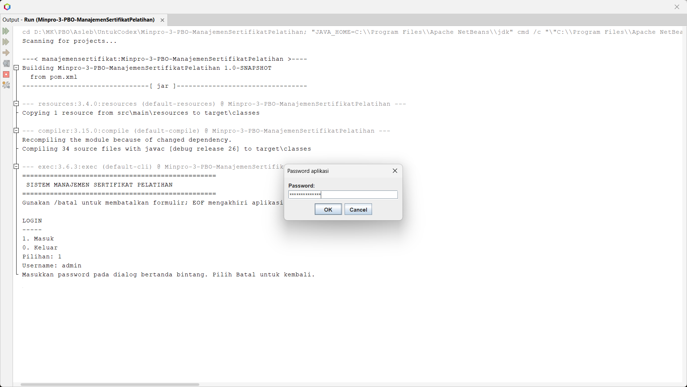

### Tabel peserta

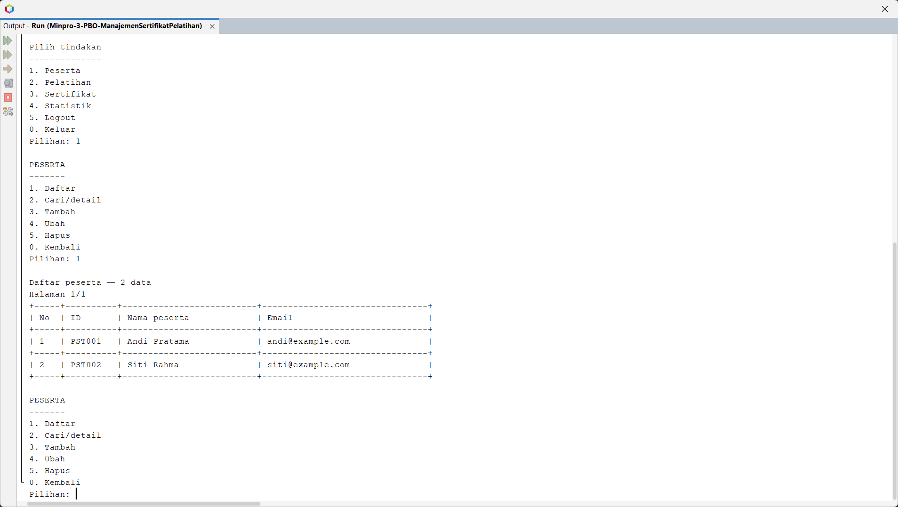

### Tabel pelatihan

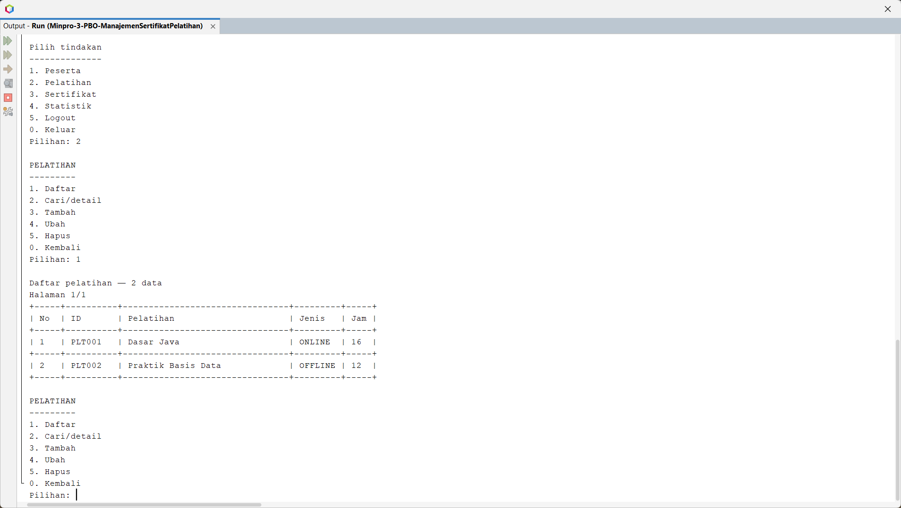

### Tabel sertifikat

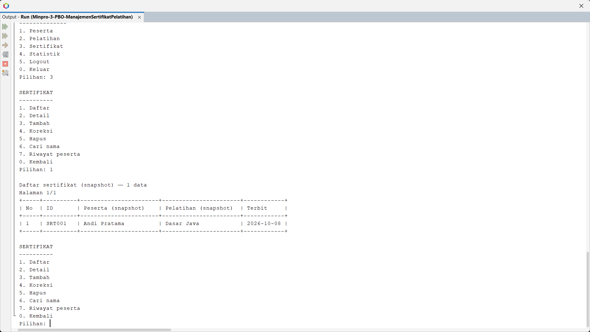

### Validasi ID dan detail snapshot

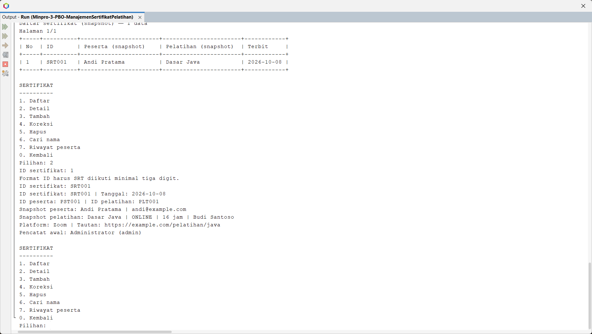

### Statistik

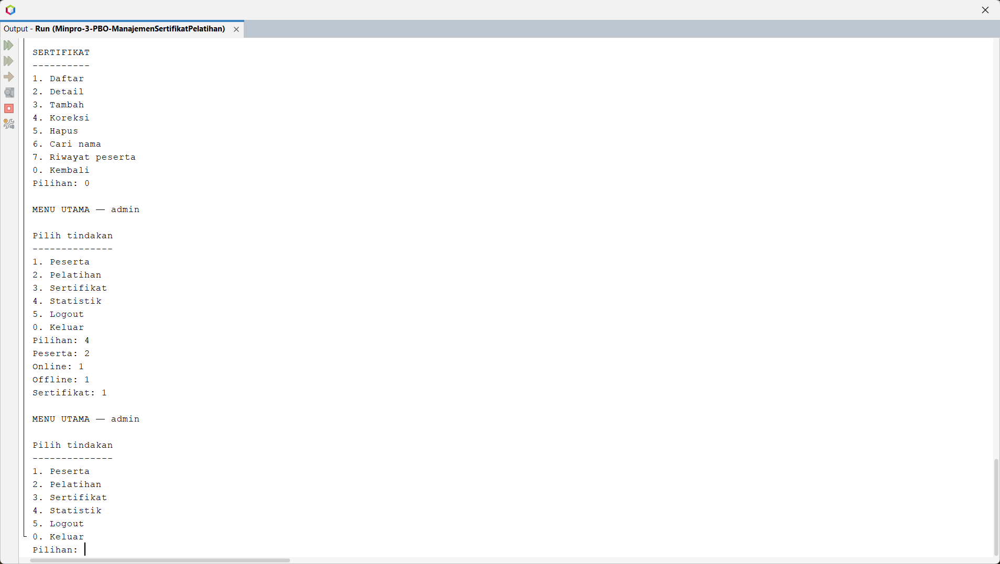

### Logout Admin dan login Petugas

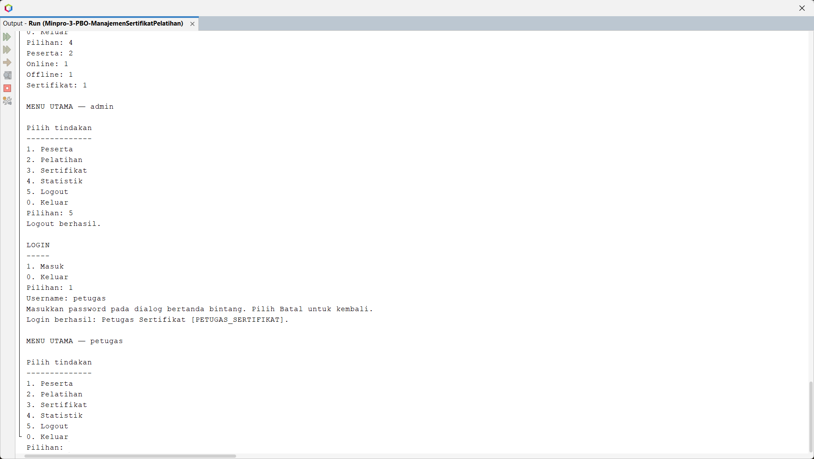
